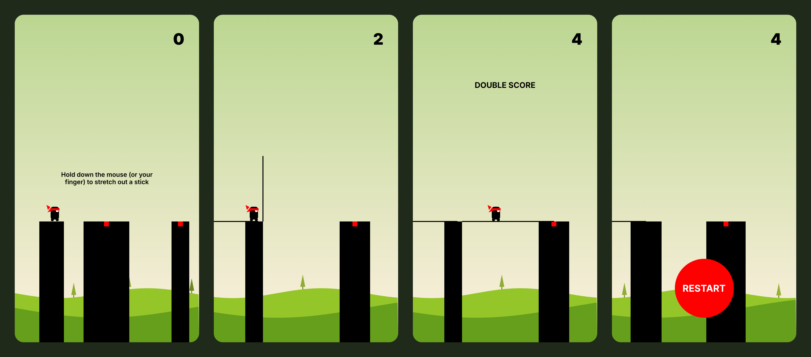
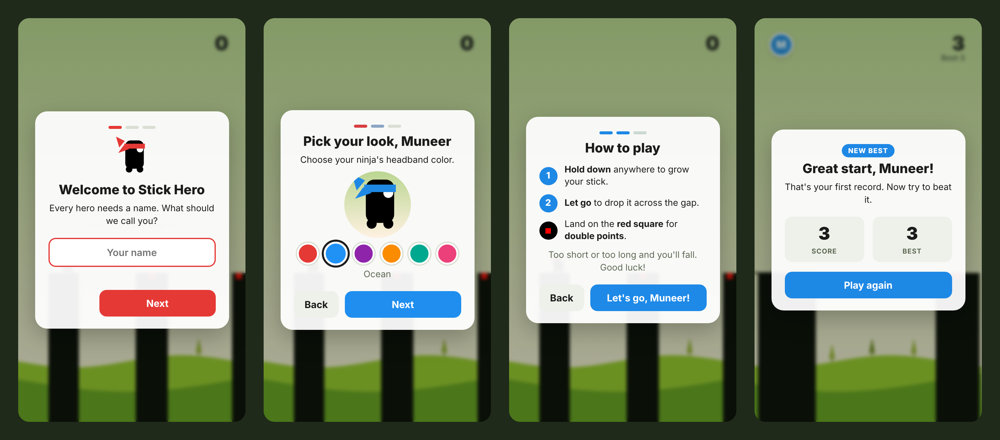
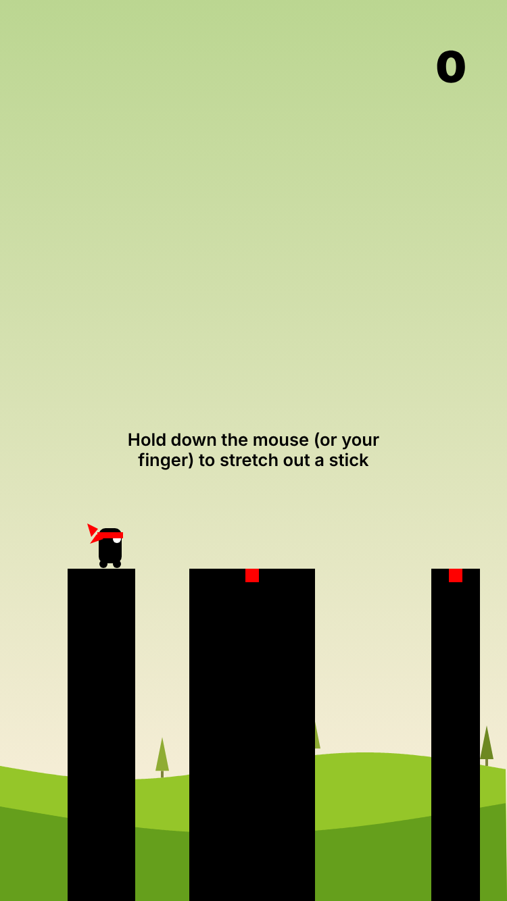
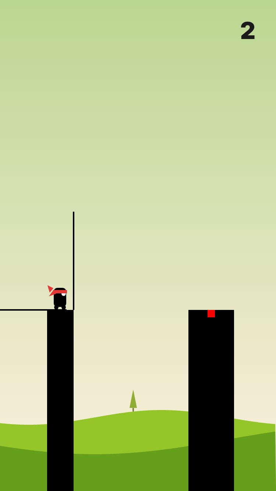
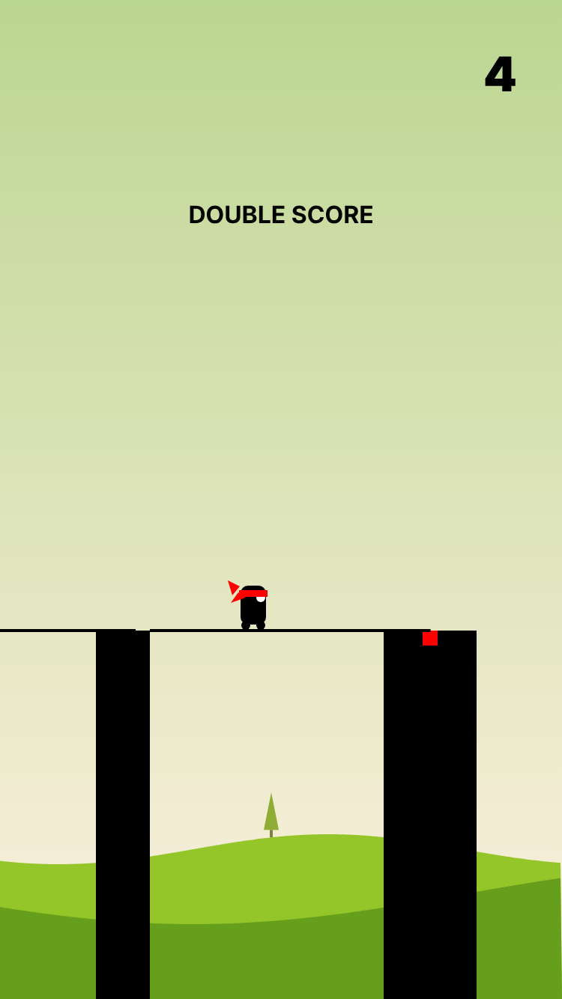
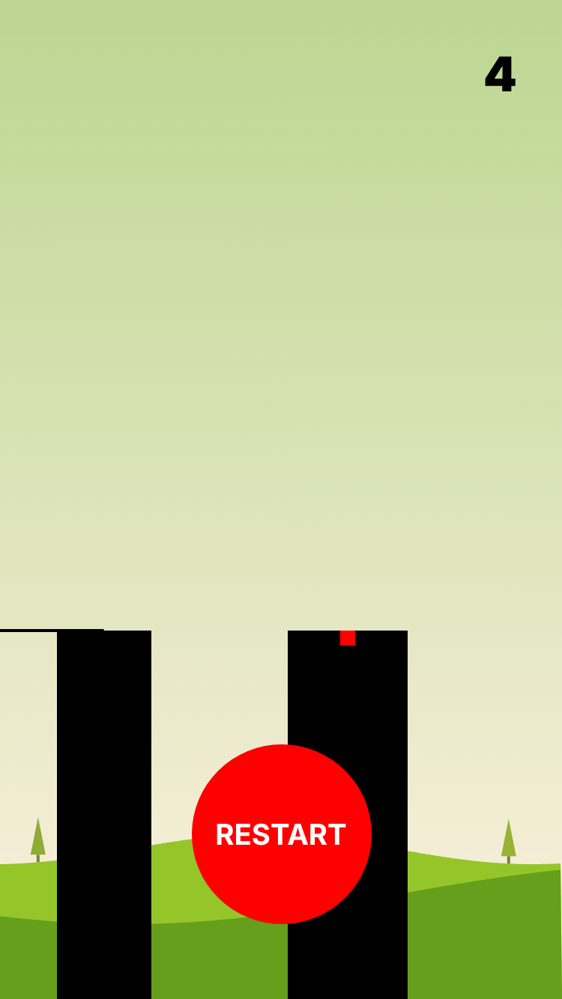
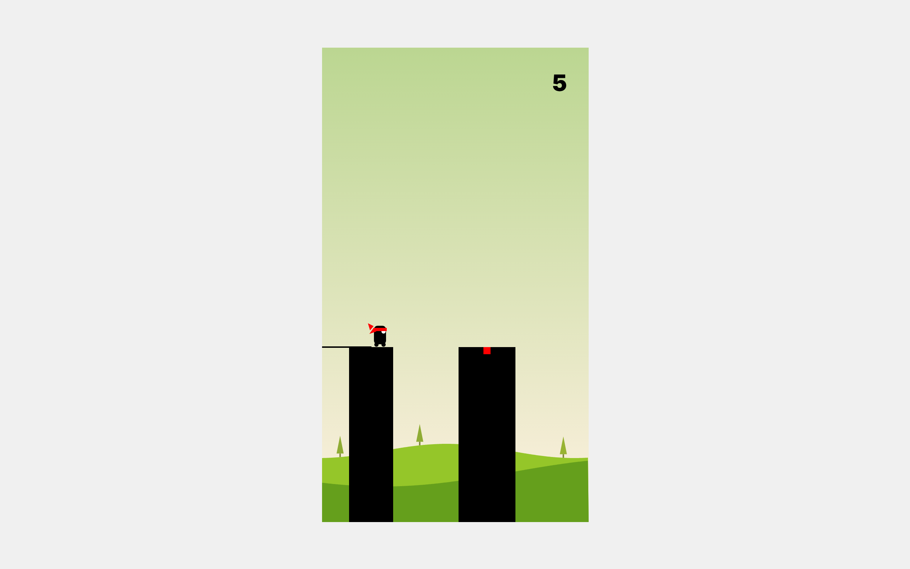

<div align="center">

# 🥷 Stick Hero

**A one-button browser arcade game built from scratch with vanilla JavaScript and the HTML5 Canvas API.**

Hold to grow a stick, release to drop it, and walk your ninja across the gap. Too short or too long and you fall.
Pick a name and a look for your ninja, and the game remembers you and your personal best.

[**▶ Play it live**](https://muneermiller.github.io/StickHeroGame/) · [Report a bug](https://github.com/MuneerMiller/StickHeroGame/issues)




</div>

## Personalized onboarding

New players get a short 3-step welcome before their first run:

1. **Name your hero.** The game greets you by name from then on.
2. **Pick your look.** Choose a headband color from six options, with a live preview. Your color also becomes the accent color for the buttons and highlights.
3. **Learn the controls.** A quick how-to-play card.

Your profile and **personal best** are saved in your browser (`localStorage`), so you're welcomed back with your record next time. The game-over screen reacts to each run: a **NEW BEST** badge, how many points you were short, or a tip after a slip. Tap your avatar in the top-left corner between runs to change your name or color.



## How to play

| Action | Mouse | Touch | Keyboard |
| --- | --- | --- | --- |
| Grow the stick | Hold the left button | Hold your finger down | – |
| Drop the stick | Release | Lift your finger | – |
| Restart | Click **RESTART** | Tap **RESTART** | <kbd>Space</kbd> |

- Each platform you reach scores **1 point**.
- Land the stick on the **red square** in the middle of a platform for a **perfect hit** and **double score**.
- If the stick is too short or too long, the hero walks off the end and falls.

## Features

- **Personalized experience.** First-run onboarding, a custom hero color, a saved personal best, and game-over messages that use your name.
- **Smooth 60 fps animation.** A `requestAnimationFrame` game loop uses time-based movement, so the speed is the same on every monitor refresh rate.
- **Simple state machine.** Each frame runs one phase: `waiting → stretching → turning → walking → transitioning`, or `falling` on a miss.
- **Procedural levels.** Platform gaps, platform widths and background trees are random, so every run is different.
- **Parallax scenery.** Sine-wave hills and trees scroll slower than the foreground to give a sense of depth.
- **Works on desktop and mobile.** Pointer events handle mouse, touch and pen in one place, and touch scrolling is turned off during play.
- **Sharp on high-DPI and Retina screens.** The canvas draws at the display's pixel ratio.
- **No dependencies.** Plain HTML, CSS and JavaScript, with no build step or framework.

## Screenshots

<p align="center">
  
  
  
  
</p>

<p align="center">
  
</p>

## Run it locally

No install is needed. Clone the repo and open `index.html` in any modern browser:

```bash
git clone https://github.com/MuneerMiller/StickHeroGame.git
cd StickHeroGame
open index.html        # macOS; on Windows use: start index.html, on Linux: xdg-open index.html
```

Or serve it locally:

```bash
python3 -m http.server 8000   # then visit http://localhost:8000
```

## Project structure

```
StickHeroGame/
├── index.html              # Page markup: canvas, HUD, onboarding and game-over panels
├── css/assets.css          # Layout and UI styling
├── javascript/profile.js   # Player profile, onboarding, personal best, personalized messages
├── javascript/stick.js     # Game loop, physics, input handling and rendering
└── docs/screenshots/     # Images used in this README
```

## How it works

1. **Stretching.** While the button is held, the current stick grows by `elapsed / stretchingSpeed` pixels each frame.
2. **Turning.** On release, the stick rotates to 90°. The game then checks whether its tip lands on a platform, and whether it lands inside the red perfect zone.
3. **Walking.** The hero walks to the far edge of the next platform, or to the end of the stick if it missed.
4. **Transitioning.** The whole scene scrolls left so the next platform moves into place, and a new platform and new trees are generated.
5. **Falling.** On a miss, the stick swings down, the hero drops off screen, and a personalized game-over panel shows your score and best.

## Credits

Built by **[Muneer Miller](https://github.com/MuneerMiller)**. Inspired by the classic Stick Hero mobile game, with game logic based on [this video tutorial](https://youtu.be/eue3UdFvwPo).

## Licence

Copyright © 2026 Mogamat Muneer Miller. All rights reserved. The code is public so you can read it and learn from it, but it is not open source. See [LICENSE](LICENSE) for details.
